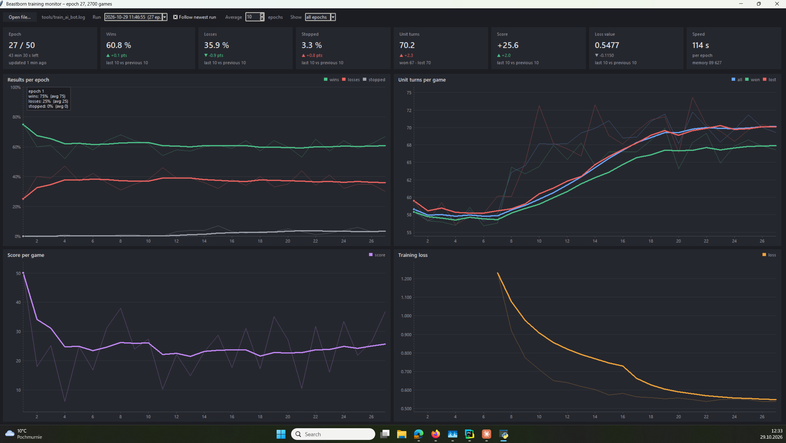
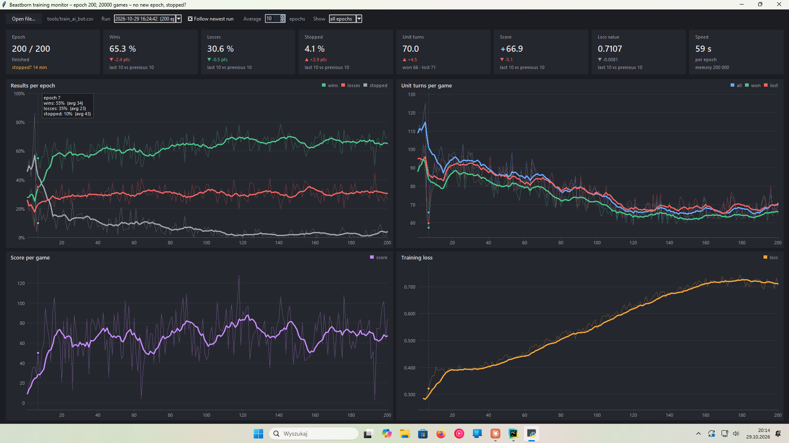

So what to do with this plato on error? Just idea no code change :)

Checking whether the flat win rate really means no progress
Here are some ideas, roughly in the order I’d try them.

1. Check that it’s really a plateau. This run plays against its own copy from the previous epoch, so a flat ~60% win rate is what you’d see even if the bot improves steadily: each version beats the one before by about the same margin. Self-play numbers can’t show whether it’s getting better overall, so you need a fixed reference:

Play snapshots against each other (epoch 25 vs 50 vs 75 vs 100). If 100 clearly beats 25, it’s still learning.
Play against a fixed opponent (random, or a simple rule-based bot) on maps it hasn’t trained on. Track that win rate over time; it’s the number that shows real progress.
2. The rising loss isn’t necessarily bad. In this kind of training (temporal-difference learning), the loss measures how well the network predicts its own moving targets, not how well it plays. It’s expected to rise when:

more games end with a real win or loss (stopped games went from 29% to 5%), so there are more big ±5 rewards to predict
the opponent gets stronger, so outcomes are less predictable.
It only matters if the predicted values start growing out of control. If they do, the usual fixes are a target network (a separate, slowly updated copy for computing targets), Huber loss and gradient clipping.

3. Check whether the bot can even see the win from early moves. With gamma 0.95 and about 40 bot turns per game, the win reward is multiplied by 0.95^40 ≈ 0.13 by the time it reaches the opening moves. So most of what the bot learns comes from the score changes and the bonus for moving toward the enemy Boss, not from winning. It may be getting good at those intermediate rewards rather than at winning. Ideas:

Raise gamma to 0.98–0.99.
Use n-step or full-game returns, so the final result reaches early moves directly.
Shrink the intermediate rewards over time once the bot has learned the basics.
4. Check whether the bot can only choose between 2 moves. If AI_MAX_RETURNED_COMMANDS = 2 also applies to the learner (not just the opponent), the network only ever picks between the 2 moves your built-in rules rank highest. Then it can never play better than “the better of those two”, which would be a hard limit on progress. I’d check this first, because it’s a ceiling no amount of training can get past.

5. Opponent variety. Playing only against the latest copy can go in circles: it learns to beat version N, forgets what beat version N−5, and so on. Ideas:

Keep a pool of older snapshots and pick an opponent from it each game, plus a random or rule-based player as a fixed anchor.
Let the opponent play greedily most of the time instead of always picking randomly between its top 2, so it’s a tougher, more consistent opponent.
6. Learning settings.

Lower the learning rate once progress stalls (1e-3 → 3e-4 → 1e-4). Plateaus at a fixed learning rate are often just the network bouncing around the best values without settling.
The replay memory holds about 44 epochs of games (200k transitions at about 4.5k per epoch). Much of it is from games against much weaker opponents. A smaller memory, or sampling recent games more often, keeps the training data closer to the bot’s current level.
7. Capacity and data.

3 residual blocks × 32 filters is small. If everything above checks out, try 5–6 blocks or 64 filters.
Fix the seed bug so it sees new maps and plays both sides of each one.
If I had to pick just two: first, make sure the learner isn’t limited to the top 2 moves (4). Then set up a fixed opponent to measure against (1), so you can tell which of the other changes actually helps.

Results of last traning(2026.10.29)

Results of tranining (2026.10.29 20:10)
