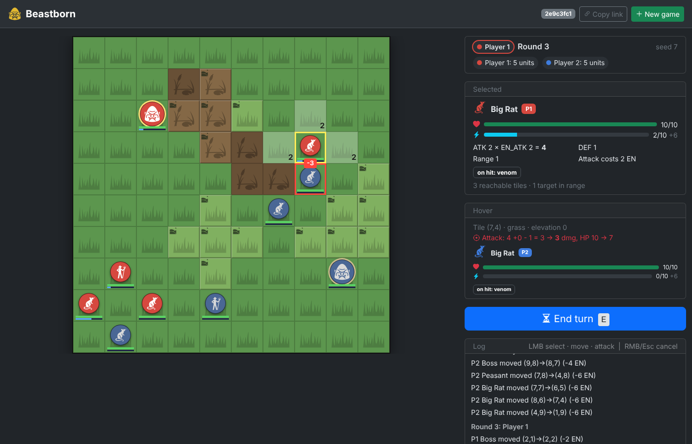

# Beastborn

Turn-based tactics for 2–4 hot-seat players, or one human against the bot. Beasts fight on a random battlefield with mud and hills.
**Combat has zero randomness.** What happens depends only on energy, position and unit stats.

Made with fun by Patryk Motyczyński.



## Run

```bash
python -m venv venv
venv\Scripts\activate            # Windows  (Linux/macOS: source venv/bin/activate)
pip install -r requirements.txt

python main.py                   # then open http://127.0.0.1:8000 and press Start
python main.py --port 9000 --reload   # other port, auto-restart on code changes
```

Requires Python 3.10+, Flask, numpy and tinygrad. Choose players (2–4), map size and an optional seed, then press **Start**.
Every game gets its own id in the URL (`/?game=<id>`). Refreshing the page keeps the game, and several games can run at once.
Games live in server memory. They are lost when the server stops and expire after 2 h without activity.
Settings: `BEASTBORN_SESSION_TTL` (seconds, default 7200) and `BEASTBORN_MAX_GAMES` (default 500).

## Deploy on PythonAnywhere
Its automatically deployed from github actions (push to main branch). Look into file deploy.yml.

## Test

```bash
python -m pytest
```

## Balance report

A desktop app (tkinter, nothing to install) that shows how the attack mechanic plays out between units.

```bash
python -m beastborn.reports.report   # or run beastborn/reports/report.py in PyCharm
```

- **Attack report:** every unit attacks every unit. A table shows rounds (and hits) to kill for each pair, and a list
  shows the target's HP after every hit and Venom tick. Choose the attacker's and defender's terrain and height on top.
- **Attack simulation:** one unit against another, step by step, with both units' stats, the next hit and an HP chart.

The attacker stands still and hits while it has energy; the target does nothing. Fights run on the real game engine.

## AI move ordering (training)

`AIFindActionStrategy` sorts the bot's candidate moves with a small neural network (tinygrad), 10x10 maps only.
Train it by playing games; progress and results go to the console and `train_ai_bot.log`:

```bash
python tools/train_ai_bot.py --games 200 --opponent random --seed 1          # a new network
python tools/train_ai_bot.py --games 200 --opponent ai --load beastborn/data/ai_bot.safetensors --seed 201
```

The weights are saved to `beastborn/data/ai_bot.safetensors` every 10 games, at the end and on Ctrl+C; the last log
line tells you how to continue (`--load ... --seed ...`). tinygrad (0.11.0, the newest for Python 3.10) runs its CPU device with
`clang`: it must be on the PATH (Windows: install LLVM, which includes clang), or name it with the `CC` environment
variable. The AI tests need it too; the rest of the game does not. Details: `docs/architecture.md`, Bots.

## Rules in short

- **Win:** kill every enemy Boss. If your Boss dies, your whole army leaves the battlefield.
- **Round and turns:** in every round each unit gets one turn. The game picks the unit, players cannot choose:
  players take turns in order (Player 1, Player 2, ..., Player 1, ...), each player's units go in a fixed order,
  and a unit that cannot move or attack right now is put off to the end of the round. Every round starts with Player 1.
- **Unit turn:** the unit regenerates `REG_EN` energy (up to `MAX_EN`), then its status effects tick (Venom).
  Units start a game with 0 energy. Then it moves and attacks until it cannot do anything more (the turn passes
  by itself) or you press End turn (the unit waits).
- **Movement** (4 directions, units block tiles):
- **Attack** enemy unit. Move can be made if needed.
- **Effects** (applied on every hit): Venom HP at the start of each of your turns. Acid  DEF permanently per hit (not yet used).
- 
## Controls (browser)

| Action | Input |
|---|---|
| Active unit | Chosen by the game (yellow frame, shown under "Active unit") |
| Move | Left click a highlighted tile (number = EN cost) |
| Attack | Left click an enemy with a red frame (hover shows exact damage). Arrows and melee hits are animated |
| Move + attack | Left click an enemy with a dashed red frame: the unit walks to the marked tile, then attacks (hover shows the path, move cost and damage) |
| Preview | Hover: path + move cost, or exact damage on a target |
| End turn (the unit waits, the next unit acts) | E / Space / button |

## Project layout

```
beastborn/
  domain/    pure data: Position, Tile, Board, UnitStats/UnitState, effects, roster loader
  engine/    Calculation Engine (CE): interface + StandardCalculationEngine (numbers in constant.py)
  game/      Game State Machine (GSM): state, commands, events, pathfinding, map generator, setup
  control/   player controllers: human, and the alpha-beta bot (bot.py, bot_voice.py), AI move ordering
  ui/        frontend-neutral intents + presenter (interface.py, interaction.py, text.py)
    web/     Flask backend (sessions, JSON API) + static/ page (jQuery + Bootstrap)
  data/      units.json, bot_lines.json, ai_bot.safetensors (AI network weights)
  reports/   report.py - desktop balance report (tkinter)
tests/       pytest suite (engine, GSM, map, UI, web API, balance report, architecture rules)
tools/       fetch_assets.py - re-downloads vendor libraries and icons; train_ai_bot.py - trains the AI network
docs/        architecture.md
main.py      entry point (local web server)
gercio_eu_pythonanywhere_com_wsgi.py   PythonAnywhere WSGI entry point (production)
```

## Web API

| Method | Path | Body |
|---|---|---|
| `POST` | `/api/games` | `{"players": 2, "size": 12, "seed": null, "bots": [1]}` → new game state (`bots`: seats played by the bot; at most 1, only with 2 players; default none) |
| `GET` | `/api/games/{id}` | → state |
| `POST` | `/api/games/{id}/intents` | `{"type": "click", "x": 3, "y": 5}` / `{"type": "end_turn"}` → state |
| `POST` | `/api/games/{id}/bot-step` | no body → the bot plays one unit turn (only while `watching`) → state |
| `DELETE` | `/api/games/{id}` | → 204 |

## Credits

Icons by Delapouite, Lorc & Sbed from [game-icons.net](https://game-icons.net) (CC BY 3.0).
jQuery, Bootstrap and Bootstrap Icons (MIT). See `beastborn/ui/web/static/CREDITS.md`.

See [docs/architecture.md](docs/architecture.md) for how to swap the rules or the UI.
