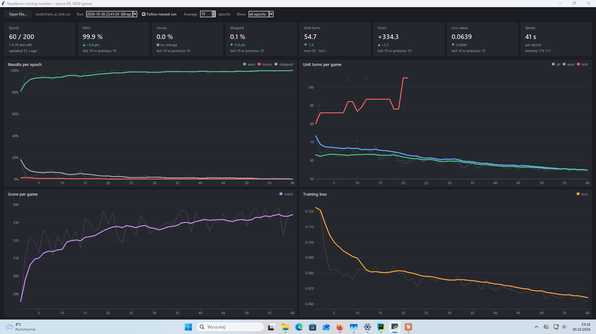
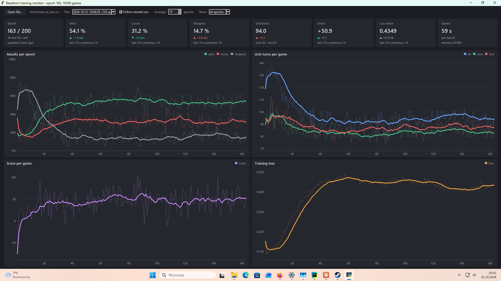
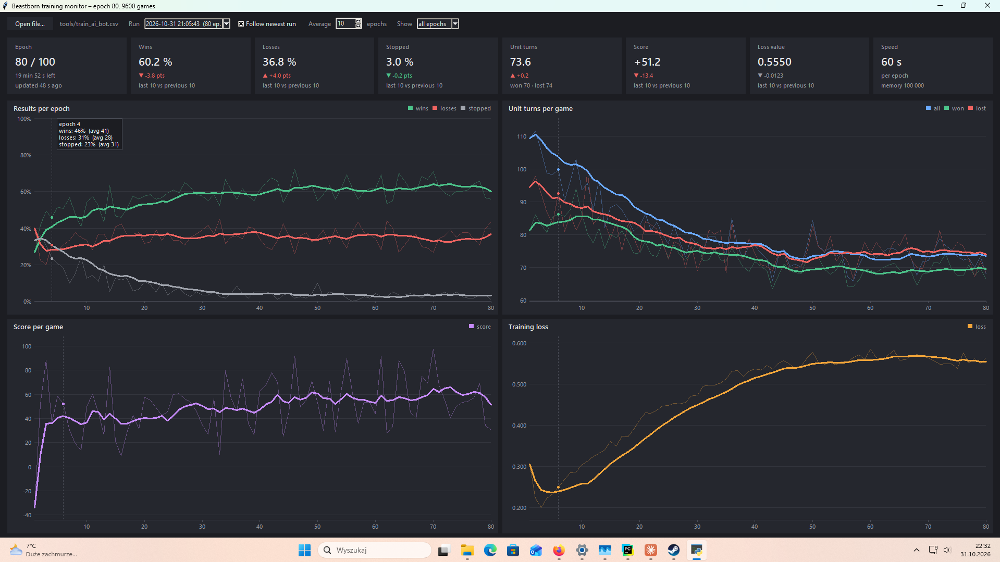

# Results of last training(2026.10.29)

# Results of training (2026.10.29 20:10)

# Results of training (2026.10.30 23:10)

# Results of training (2026.10.31 22:10)

Does not look good at all. Added additional layers for Conv2D.

# Results of training (2026.10.31 23:10)

Looks kind of better. The idea to improve is to AI_STEP_COST should be scaled with leaving units!.